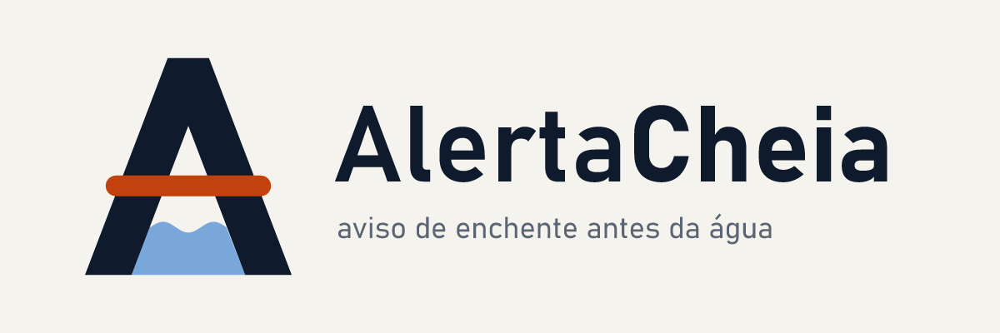

<p align="center"></p>

# AlertaCheia: aviso de enchente para o seu bairro, antes de a água chegar

**Global Solution 2026/2 · CitizenTech · FIAP · Engenharia de Software (4ESOA)**

Sensores nos córregos medem o nível, a chuva e a umidade do solo. Uma IA prevê o transbordo
**duas horas antes**, e um agente de IA generativa escreve um alerta claro que chega por SMS
ao morador, cerca de **1 hora antes da água**. A Defesa Civil acompanha tudo num painel.

> 🎬 **Vídeo pitch:** <COLE AQUI O LINK PÚBLICO>
> 👥 Integrantes, RMs e link: [`GRUPO.txt`](GRUPO.txt)

| Resultado (14 enchentes de teste) | Sem sistema | Régua atual | **AlertaCheia** |
|---|---|---|---|
| Aviso antes da água (média) | 0 min | 41,8 min | **73,9 min (+32 min)** |
| Enchentes sem aviso prévio | 14 | 0 | **0** |
| Falsos alarmes por semana | — | 1,2 | 1,4 |

ODS 11 · 13 · 10 · 3 · 9. Explicação completa em [`docs/01-solucao.md`](docs/01-solucao.md).

---

## Requisitos

- **Python 3.11 ou superior** (testado em 3.11 e 3.14)
- **Node.js 20 ou superior**, só para recompilar o frontend
- **Docker** (opcional)

Os comandos abaixo são para o **Windows (PowerShell)**. No Linux ou no macOS, troque
`.venv\Scripts\` por `.venv/bin/`.

## Como rodar (uma vez)

```bash
python -m venv .venv
```

```bash
.venv\Scripts\pip install -r requirements-dev.txt
```

```bash
.venv\Scripts\python run_pipeline.py
```

Voz neural do "Ouvir o alerta" (opcional, ~60 MB; sem ela o navegador lê o alerta com a voz do sistema):

```bash
.venv\Scripts\python -m piper.download_voices pt_BR-faber-medium --data-dir modelos/voz
```

```bash
npm --prefix frontend install
```

```bash
npm --prefix frontend run build
```

```bash
.venv\Scripts\python -m api.main
```

Abra **http://localhost:8080**. O contrato da API está em http://localhost:8080/docs.

- O `run_pipeline.py` gera o histórico, monta o Data Lake, treina e avalia o modelo e cria o
  exemplo da IA. Leva cerca de 4 segundos.
- **Login da Defesa Civil** (valores de desenvolvimento, troque no `.env`): usuário
  `defesacivil`, senha `alerta@2026`.
- **IA generativa:** é opcional. Copie `.env.example` para `.env` e preencha
  `ANTHROPIC_API_KEY`. Sem a chave, o alerta é redigido pelo gerador determinístico, e a tela
  mostra qual dos dois redigiu.

### Ou com Docker (tudo em um comando)

```bash
docker compose up --build -d
```

O painel abre em http://localhost:8080. Para ver as 5 estações mock publicando:

```bash
docker compose --profile demo run --rm sensores --tempestade EST-03
```

---

## Como rodar cada área

### Área 1: IA e automação → [`docs/03-ia.md`](docs/03-ia.md)

```bash
.venv\Scripts\python -m ia.treinar
```

Treina o Random Forest e imprime as métricas: ROC AUC, antecedência × régua e falsos alarmes.
O resultado fica em `ia/artefatos/metricas.json`.

```bash
.venv\Scripts\python -m ia.alerta_generativo
```

Mostra a **entrada e a saída** do agente generativo, com um caso real do período de teste.

### Área 2: Big Data e visualização → [`docs/04-big-data.md`](docs/04-big-data.md)

```bash
.venv\Scripts\python -m dados.gerador
```

```bash
.venv\Scripts\python -m dados.pipeline
```

O gerador cria o bronze e o pipeline faz bronze → silver → gold, mais a quarentena. Tudo fica
em `datalake/`.

- **Dashboard web:** `http://localhost:8080/painel` (filtros por estação e período).
- **Power BI:** os CSVs ficam em `datalake/gold/*.csv`. Siga o passo a passo de
  [`powerbi/README.md`](powerbi/README.md) e cole as medidas de
  [`powerbi/medidas.dax`](powerbi/medidas.dax).

### Área 3: MVP, IoT e experiência digital → [`docs/05-mvp-iot.md`](docs/05-mvp-iot.md)

Com a API no ar (`python -m api.main`), há três formas de gerar leituras:

```bash
.venv\Scripts\python -m iot.serial_para_api iot\exemplo_serial_tinkercad.txt
```

Envia a captura do TinkerCad para a API. A borda e a nuvem aparecem lado a lado.

```bash
.venv\Scripts\python -m iot.simulador --tempestade EST-03
```

Liga os 5 sensores mock, com um temporal no Aricanduva.

A terceira forma é pelo painel da Defesa Civil: botão **"Simular chuva"**.

Para montar a estação no TinkerCad, siga [`iot/GUIA_TINKERCAD.md`](iot/GUIA_TINKERCAD.md). O
sketch é `iot/estacao_cheia/estacao_cheia.ino`.

Para desenvolver o frontend com recarga automática:

```bash
npm --prefix frontend run dev
```

O endereço é http://localhost:5173, com o `/api` repassado para a porta 8080.

### Área 4: DevOps, segurança e qualidade → [`docs/06-devops-seguranca-testes.md`](docs/06-devops-seguranca-testes.md)

```bash
.venv\Scripts\python -m pytest -v
```

Roda os 18 casos do plano de testes (32 execuções) num ambiente isolado.

```bash
.venv\Scripts\ruff check .
```

```bash
.venv\Scripts\bandit -r alertacheia api dados ia iot -c pyproject.toml
```

```bash
.venv\Scripts\pip-audit -r requirements.txt
```

Ruff é o lint, Bandit faz a análise estática de segurança (SAST) e pip-audit verifica
vulnerabilidades nas dependências (SCA).

```bash
docker build -t alertacheia .
```

```bash
docker run -p 8080:8080 alertacheia
```

O CI/CD está em [`.github/workflows/ci.yml`](.github/workflows/ci.yml): lint, segurança,
testes, frontend, imagem Docker com smoke test e Trivy, e publicação no GHCR a cada push na
`main`. Para ele rodar, esta pasta precisa ser a raiz do repositório no GitHub.

---

## Estrutura

```
alertacheia/   núcleo: configuração (cotas, limiares, estações), atributos, hidrologia
dados/         gerador do histórico e pipeline do Data Lake
ia/            modelo de risco, avaliação, prompts e agente generativo
api/           FastAPI: rotas, segurança, banco operacional, regras de negócio
iot/           sketch Arduino (TinkerCad), ponte serial, sensores mock
frontend/      React + Vite (7 telas)
powerbi/       medidas DAX e roteiro do relatório
tests/         pytest (18 casos)
docs/          documentação por área, arquitetura, roteiro do pitch e evidências
```

Mapa da entrega:

| Requisito | Onde está |
|---|---|
| Arquitetura | [`docs/arquitetura.svg`](docs/arquitetura.svg) · [`docs/05-mvp-iot.md`](docs/05-mvp-iot.md) §4 |
| IA aplicada · prompts · demo · ganho | [`docs/03-ia.md`](docs/03-ia.md) · `docs/evidencias/exemplo_alerta_ia.json` |
| Estrutura · ingestão · dashboard · DAX | [`docs/04-big-data.md`](docs/04-big-data.md) · [`powerbi/`](powerbi/) |
| Telas · IoT · fluxo | [`docs/05-mvp-iot.md`](docs/05-mvp-iot.md) · [`iot/`](iot/) |
| Git · DevOps · segurança · testes | [`docs/06-devops-seguranca-testes.md`](docs/06-devops-seguranca-testes.md) · `docs/evidencias/` |
| Roteiro do pitch | [`docs/roteiro-pitch.md`](docs/roteiro-pitch.md) |

## Dados e créditos

- **As leituras dos sensores, as cotas e a população por bairro são simuladas.** Os bairros
  existem e têm histórico conhecido de alagamento, mas os números do protótipo não são
  medições reais. A série é gerada por `dados/gerador.py` com um modelo hidrológico
  simplificado (`alertacheia/hidrologia.py`).
- Dado real citado: IBGE/Cemaden, [*População em áreas de risco no Brasil*](https://www.ibge.gov.br/geociencias/informacoes-ambientais/estudos-ambientais/21538-populacao-em-areas-de-risco-no-brasil.html), com base no Censo 2010.
- Bibliotecas de código aberto: FastAPI, pandas, scikit-learn, PyArrow, React, Recharts, Vite.
  Telefones de emergência: Defesa Civil 199 e Bombeiros 193.

## Uso de IA generativa no desenvolvimento

| Ferramenta | Para quê |
|---|---|
| Claude (Anthropic), via Claude Code | apoio na estruturação do código, revisão, explicação de erros e redação da documentação. Todo o código foi revisado, executado e testado pelo grupo, e o grupo sabe explicar cada parte |
| API Claude (no produto) | o agente que redige o alerta ao morador ([`ia/alerta_generativo.py`](ia/alerta_generativo.py)), com fallback determinístico |
