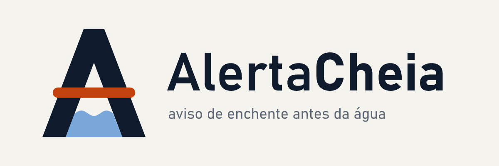

# Marca AlertaCheia

## Ideia

O símbolo é o **"A" de Alerta**:
- a **barra laranja** atravessando o A é a linha de alerta, a régua do córrego;
- a **água**, em azul, sobe dentro do A, **abaixo** dessa linha.

O espaço entre a água e a linha é o tempo que o sistema ganha. A marca resume a promessa do
produto: o aviso chega antes da água.

## Arquivos

| Arquivo | Uso |
|---|---|
| `logotipo-claro.svg/png` · `logotipo-escuro.svg/png` | composição horizontal (README, PDF, slides) |
| `simbolo-claro` · `simbolo-escuro` | só o símbolo, para espaços quadrados |
| `simbolo-1cor` | impressão em uma cor, carimbo, gravação (a água e a barra se separam por um respiro branco) |
| `icone.svg` · `icone-512/180/32.png` | versão reduzida, com pernas mais grossas e onda simplificada: avatar do GitHub, favicon, apple-touch-icon |
| `social-preview.png` | imagem de compartilhamento do repositório no GitHub (1280×640) |
| `AlertaCheia-marca.vectorcraft` | arquivo-fonte editável no VectorCraft |

## Cores

| Papel | HEX | Onde |
|---|---|---|
| Tinta (primária) | `#0f1b2d` | A, textos, fundo escuro |
| Papel (fundo) | `#f5f3ee` | fundo claro, A no negativo |
| Alerta (acento) | `#c2410c` no claro · `#e0571c` no escuro | só a linha de alerta e os destaques críticos |
| Água | `#7aa7d9` | só a água do símbolo e os gráficos de chuva |

## Tipografia

Bahnschrift (DIN): SemiBold em "Alerta" e Bold em "Cheia". É o desenho das placas de
sinalização pública, coerente com um serviço da Defesa Civil. Nos SVGs, os textos estão
convertidos em curvas.

## Não faça

- não troque a cor da linha de alerta;
- não ponha a água acima da linha (isso inverte a mensagem);
- não estique, gire nem aplique sombra ou degradê;
- não use o símbolo completo abaixo de 48 px: use o `icone`.

## Verificação

- teste de 16 px e 32 px: o A e a barra laranja continuam legíveis;
- versão em 1 cor;
- negativo;
- teste cego com um avaliador sem contexto: leu "serviço de alerta de enchente, monitoramento de
  nível de rio, para a população ou a Defesa Civil".
